# TinyMCE and CKEditor table interactions

Research date: 20 November 2026. First comparison pass; no editor changes made.

The strongest candidate to borrow is **a compact set of row, column, and cell
actions close to the table, with less frequent properties kept separate**.
We should compare that against our existing labelled toolbar before deciding
whether floating controls justify their added focus and positioning work.

## Evidence and method

| Product | Version observed at runtime | Live demo |
| --- | --- | --- |
| TinyMCE | 8.10.2, read from `tinymce.majorVersion` and `minorVersion` | [Non-Premium Plugins demo](https://www.tiny.cloud/docs/tinymce/latest/full-featured-open-source-demo/) |
| CKEditor 5 | 49.1.0, read from `CKEDITOR_VERSION` | [Tables overview demo](https://ckeditor.com/docs/ckeditor5/latest/features/tables/tables.html#demo) |

Browser: Chrome 157 on a macOS user agent; 1280×800 CSS pixels, device pixel
ratio 1. Screenshots retain the websites' surrounding context and branding.
TinyMCE's demo uses a dark editor skin; CKEditor uses a light one. This is not
a comparison of our preferred colors, spacing, or themes.

Insertion was exercised through each demo's grid. For subsequent tasks, a
shared 3×3 fixture was loaded through the editors' own content APIs:

| Product | Quantity | Status |
| --- | --- | --- |
| Apples | 4 | Available |
| Pears | 9 | Ordered |

TinyMCE's fixture has a full-width bordered table; CKEditor's uses its demo's
intrinsic sizing. Do not infer relative table sizing quality from these images.
Later captures show the real effects of earlier merge/split and property edits.
TinyMCE's undo history was reset after reseeding the fixture; an earlier undo
across fixture replacement was excluded from content-preservation conclusions.

**Observed** means exercised in the live browser and checked against the
selection or generated data. **Documented** means stated by the vendor.
**Proposal** means an interpretation to review, not an implemented change.
The [capture index](screenshots/README.md) records all 17 screenshots and their
source. Current Wagtail demo screenshots and usability sessions remain pending.

## 1. Where actions appear

**TinyMCE — observed:** a nearby toolbar exposes direct structural actions;
the Table menu remains another entry point.

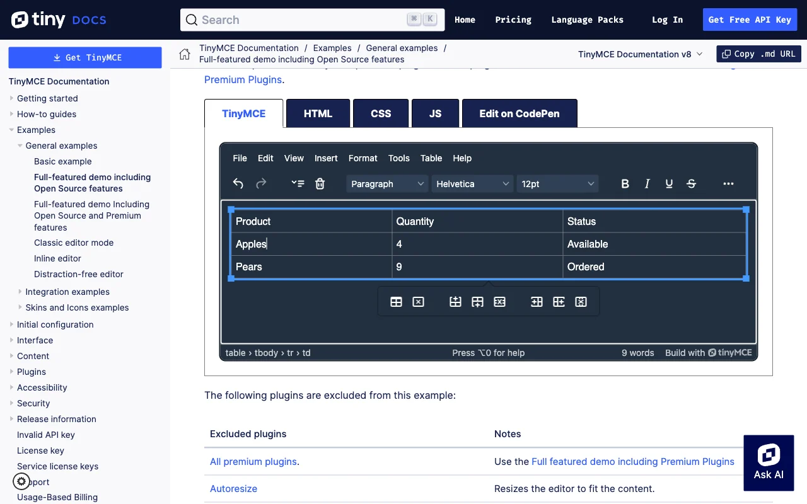

**CKEditor — observed:** a compact contextual toolbar groups operations behind
Row and Column menus, alongside cell and properties controls. It disappeared
when focus moved outside the editor.

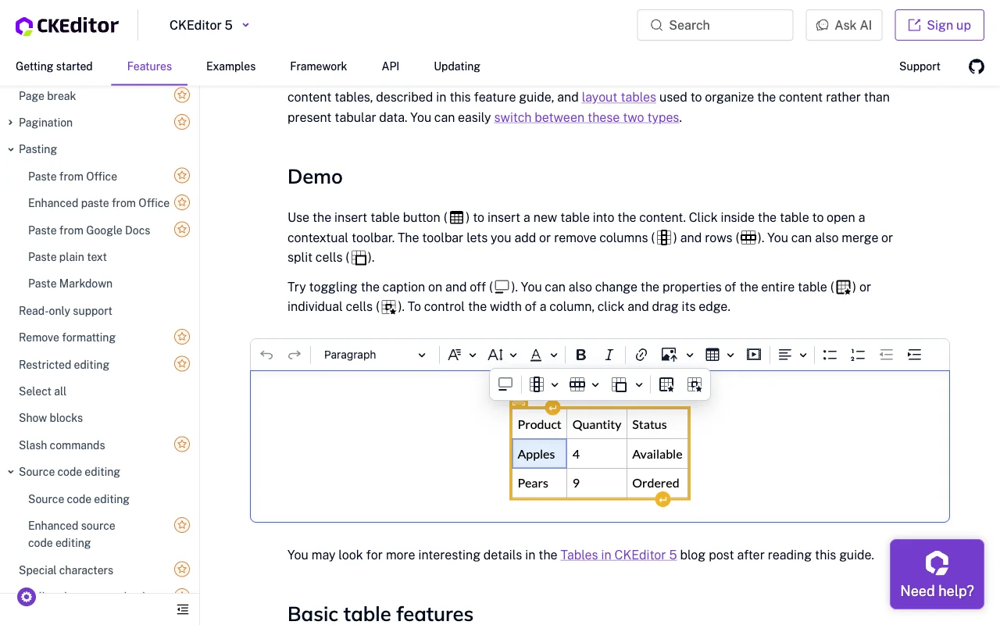

**Proposal:** compare a few clearly labelled controls against an icon strip.
Proximity may reduce pointer travel, but unfamiliar icons add a discovery cost.
Do not remove the discoverable Wagtail entry point just because a contextual
toolbar looks smaller. A toolbar must remain usable when focus enters it.

TinyMCE's [table toolbar configuration](https://www.tiny.cloud/docs/tinymce/latest/table/#table_toolbar)
and CKEditor's [contextual toolbar documentation](https://ckeditor.com/docs/ckeditor5/latest/features/tables/tables.html#table-contextual-toolbar)
describe these as configurable arrangements, not universal defaults.

## 2. Rows and columns: group by the object being changed

**Observed:** both demos offer grouped structural commands. Browser probes
confirmed a row insertion in CKEditor changed three rows to four, and a column
insertion in TinyMCE changed three columns to four.

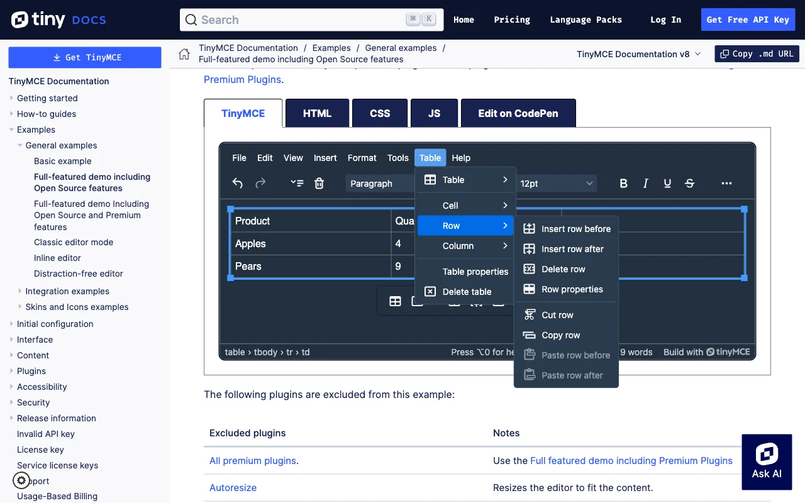

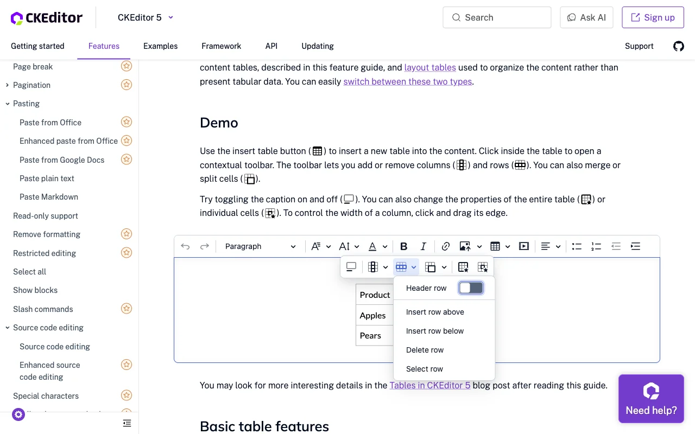

TinyMCE's [Column menu capture](screenshots/tinymce-column-menu.webp) shows the
parallel grouping. In CKEditor, the Column menu was also reached by keyboard.

**Proposal:** investigate labelled Row and Column menus in place of our action
selects. Keep the current native command semantics explicit: structural actions
apply to the selection, while our header conveniences refer to the first edge.
Do not copy a label such as “Header row” if it would hide that distinction.

## 3. Selection comes before merge and split

**Observed:** pointer dragging selected two adjacent cells in each demo.
Using the merge control then combined those cells; splitting restored separate
cells. The output retained both text values, combined in the first split cell.
CKEditor's menu distinguished directional merges and directional splits.

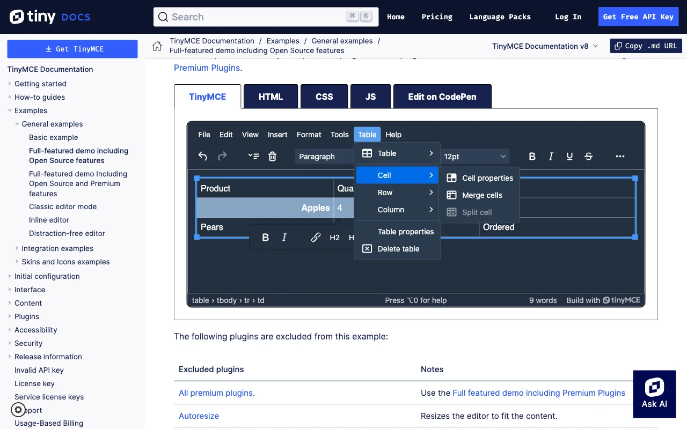

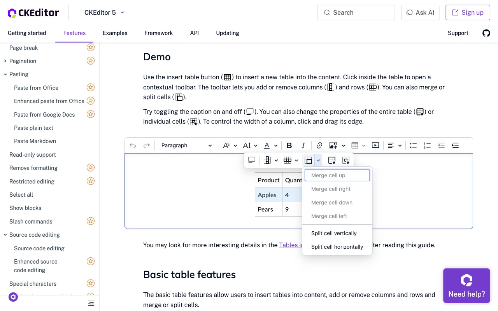

The unobstructed selection captures are available for
[TinyMCE](screenshots/tinymce-multiple-cells.webp) and
[CKEditor](screenshots/ckeditor-multiple-cells.webp).

**Proposal:** keep merge/split availability tied to native selection and command
capability. Test that opening a menu preserves the rectangle, not just that the
button looks enabled. Borrow the visual grouping without adding a second table
manipulation implementation. We do not need every directional operation in a
first refinement.

## 4. Cell properties: semantics and alignment

**Observed:** both demos applied an individual header cell with row scope and
right/bottom alignment to the intended cell. Their output contained `th` and
`scope="row"`; unrelated cells remained data cells. Opening and saving properties
retained the target selection.

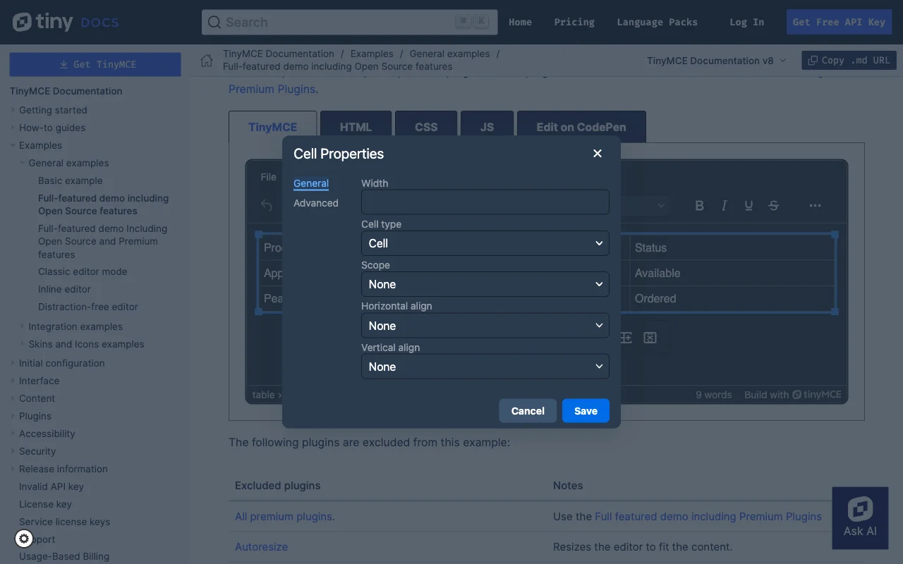

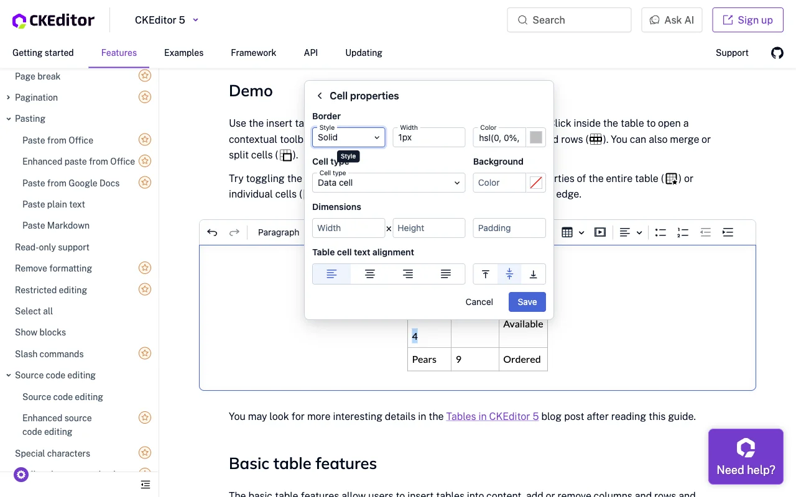

The type choices are visible in the
[TinyMCE dropdown](screenshots/tinymce-header-types.webp) and
[CKEditor dropdown](screenshots/ckeditor-header-types.webp).

This updates the [historical report](history/README.md): its CKEditor 5 header
limitation is not a current finding. Current CKEditor documentation also covers
[individual cell type and scope](https://ckeditor.com/docs/ckeditor5/latest/features/tables/tables.html#table-cell-type).
That does not establish accessibility for arbitrary merged tables.

**Proposal:** make the scope of settings clear: selected cells versus the whole
table. Prioritize headers and alignment over border, background, and dimension
controls that this package does not support. A compact properties panel can
remain in Wagtail's design language; it need not reproduce either vendor's UI.

## 5. Choosing table dimensions

**Observed:** both grid pickers highlighted a 3×3 range and inserted nine cells
when activated.

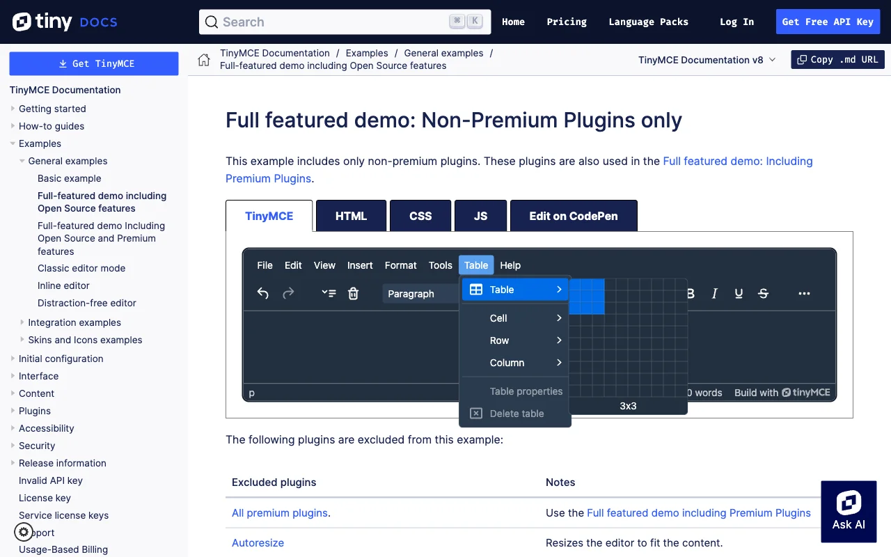

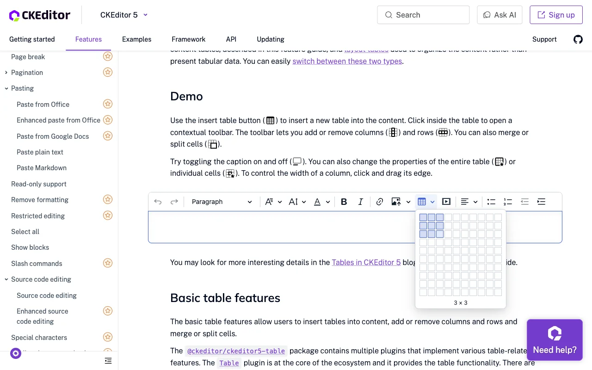

**Proposal:** keep our automatic 3×3 starter table for now. If editors need an
initial size choice, compare simple labelled row/column inputs with a grid
picker. Pointer convenience alone is not enough reason to build and maintain
an accessible grid widget. Its keyboard use was not tested in this pass.

## 6. Caption: metadata or direct editing?

**Observed:** CKEditor's caption toggle revealed an editable caption, moved focus
there, and accepted “Stock overview”. Its output was a figure caption, which is
different from this package's server-rendered HTML table caption.

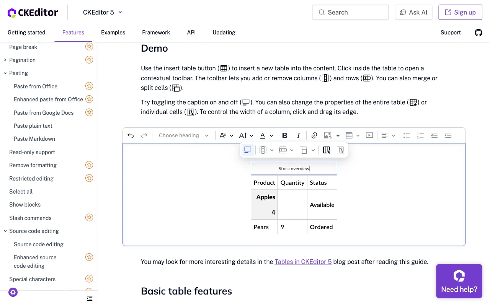

TinyMCE exposed a caption checkbox in Table Properties. The attempt to activate
that checkbox through automation was inconclusive; only the visible control is
recorded here.

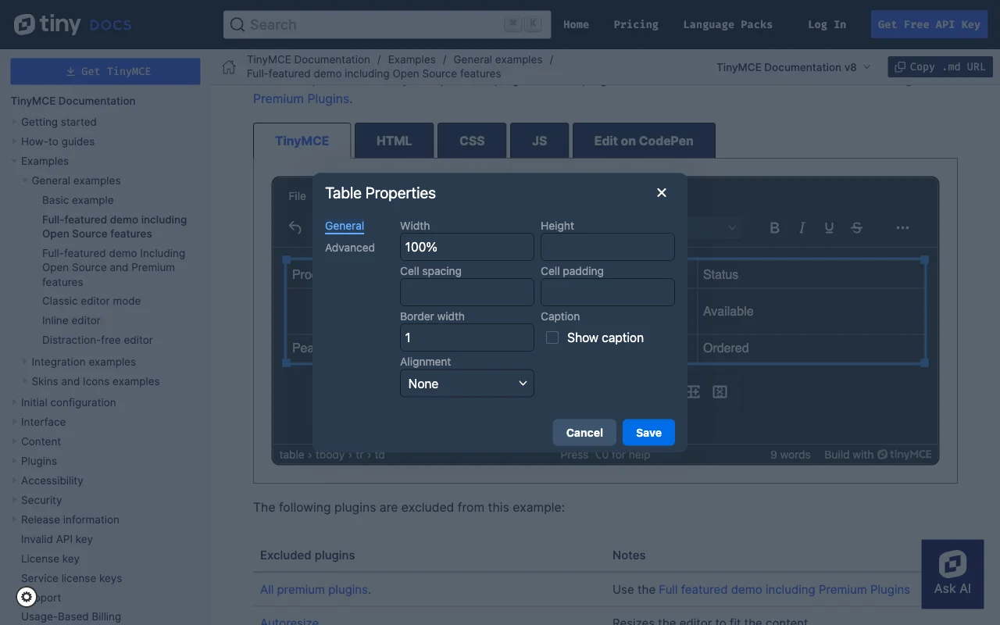

**Proposal:** evaluate placing the caption field nearer the table, while keeping
its meaning separate from the description. Neither this observation nor a
vendor's output format is a reason to change our stored schema or renderer.
Description-field workflows were not evaluated in these demos.

## Keyboard and focus checks

| Check | TinyMCE | CKEditor 5 |
| --- | --- | --- |
| Tab / Shift+Tab between fixture cells | Observed Product → Quantity → Product. | Observed Product → Quantity → Product. |
| Reach controls from a cell | Alt+F10 reached the main toolbar; Ctrl+F9 reached Table properties in the contextual toolbar. | Alt+F10 reached the table toolbar. |
| Navigate a structural menu by keyboard | Not completed. | ArrowRight then ArrowDown reached the Column menu and its Header column control. |
| Return to the cell with Escape | Inconclusive: focus remained on a toolbar button in the automation probe. Needs manual reproduction. | Two Escapes closed the menu and returned focus to the editable cell. |
| Screen-reader announcements and grid-picker keyboard use | Not tested. | Not tested. |

TinyMCE [documents Escape focus return and its focus shortcuts](https://www.tiny.cloud/docs/tinymce/latest/keyboard-shortcuts/).
The inconclusive probe is not a claim of an accessibility defect. Screenshots
alone establish none of the keyboard results above. This was one desktop Chrome
session, not a cross-browser or accessibility conformance review.

## Proposed experiments for wagtail-table

These require review before implementation. Keep Tiptap/ProseMirror as the
editing engine and Wagtail as the integration and visual foundation.

1. **Try labelled Row, Column, and Cell action groups in the existing toolbar.**
   Compare menus against the current selects and cell-action row. This is the
   smallest experiment: it can test grouping without introducing floating UI.
2. **Evaluate a nearby contextual toolbar using the same commands.** Check
   Tiptap's existing menu support before writing positioning logic. Keep a
   discoverable keyboard entry point. Exercise menu focus, scroll/viewport
   boundaries, multiple StreamField blocks, and wide tables before deciding
   whether proximity is worth the extra behavior.
3. **Clarify selected-cell versus table-wide properties.** Keep headers,
   alignment, caption, and description easy to distinguish. Prototype a compact
   arrangement before adding richer styling or hybrid-cell controls.

Use the same tasks to compare prototypes: add a row, add a column, merge/split a
rectangle, change selected-cell alignment, set headers, and edit metadata. A
change succeeds only if selection survives control use, keyboard focus is
predictable, controls stay reachable, and save/reload behavior remains intact.
Do not add all three experiments at once.

## Limits and next evidence

- Capture and review the current editor in a real Wagtail StreamField. Code
  inspection informed the proposals, but no new Wagtail baseline screenshots or
  side-by-side usability test were produced in this pass.
- Test wide tables, scrolling, narrow viewports, touch, and screen readers.
  These demos' responsive documentation pages are not substitutes for StreamField.
- Check row/column-wide property changes and complex merged-header relationships.
  Single-cell HTML inspection does not establish a full accessibility solution.
- Right-click menus were not exercised; the Table menu and contextual toolbars
  shown here do not establish right-click behavior.
- External spreadsheet/Word clipboard interoperability remains separate work.
- No dependencies were installed and no vendor code, icons, styling, or plugins
  were copied into the package. This study does not select a different editor
  engine or introduce hybrid cells.
