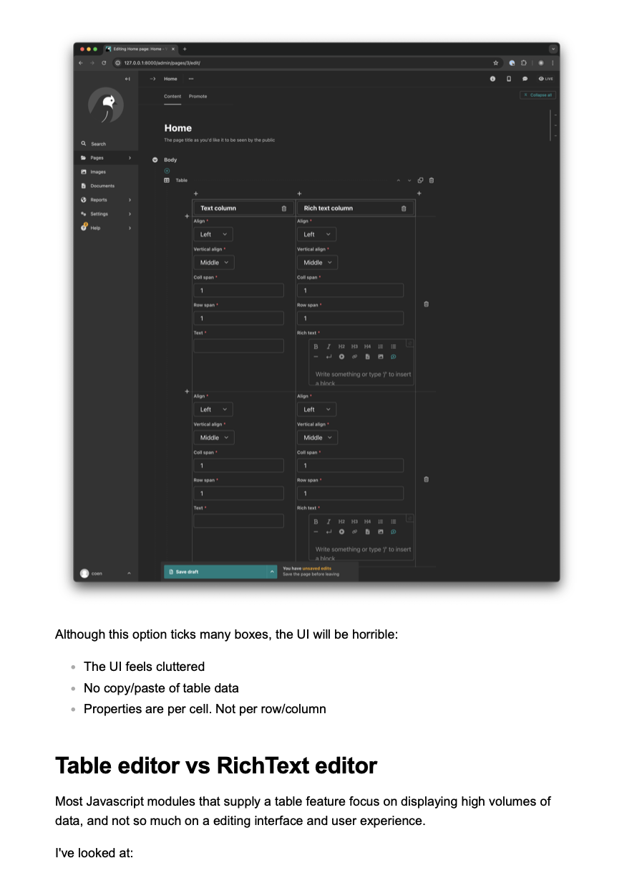
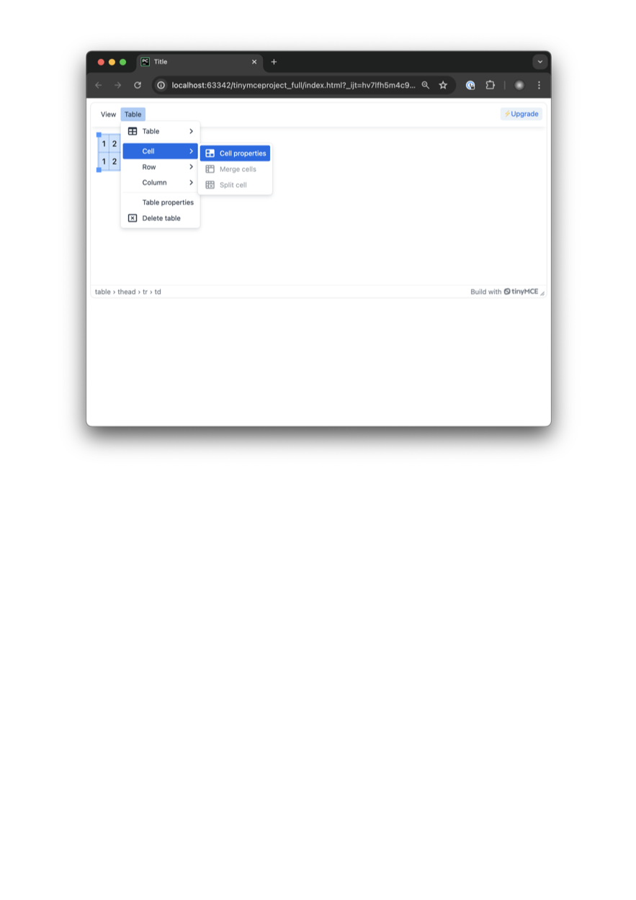
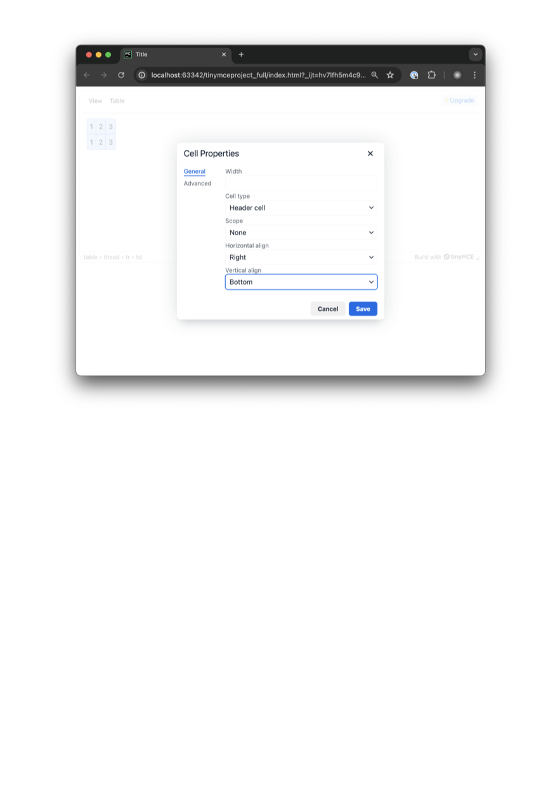

# Original table editor investigation

Source: [original-table-editor-report.pdf](original-table-editor-report.pdf),
11 pages. The visible opening heading is “Table”. Reviewed on 20 November 2026.

The PDF creation and modification metadata both read 17 July 2024. This dates
the exported artifact; it does not establish when the research was conducted.
No author is recorded in the PDF metadata, so attribution remains to be confirmed.
The original PDF is preserved unchanged. This document is a summary, not a
transcription or a new evaluation of the products mentioned.

## What the report investigated

| Pages | Subject | Historical observations and conclusions |
| --- | --- | --- |
| 1 | Requirements and semantic HTML | First-row, first-column, and individual header cells; merging in both directions; horizontal and vertical alignment. Existing customized table behavior should be preserved. |
| 2–3 | Wagtail TableBlock and Handsontable | The report tested the then-used Handsontable 6.2.2 integration and a separate 14.4.0 trial. It recorded limitations around headers, alignment, and merge discoverability, plus a mismatch between editor features and a site's custom rendering templates. Version, license, and price references describe that investigation only. |
| 3–4 | TypedTable proof of concept | Per-cell configuration could expose the needed features, but the report found the interface cluttered, lacking table-data copy/paste, and inconvenient for row/column-wide changes. |
| 4–5 | Grid components versus table-focused rich-text editing | The investigation moved from data-display components toward restricting an existing rich-text editor to table editing. AG Grid, Tabulator, and Quill are mentioned, without a detailed comparative study. |
| 5–8 | TinyMCE | The report records support for the required headers, merging, and alignment. Screenshots show table menus, cell properties, and row properties. |
| 8–10 | CKEditor | The report records a limitation concerning individual header cells in the CKEditor 5 version examined, then compares CKEditor 4. These are historical findings; present-day behavior has not been checked. |
| 10–11 | Conclusion and Wagtail example | The author preferred a table-only TinyMCE StreamField integration. The last page shows a Wagtail editor containing that table interface. It is evidence of a pictured example, not proof of a complete tested integration. |

## Visual starting points

The following images are page renders from the supplied historical PDF. They
retain its embedded screenshots and surrounding context. They are not fresh
product captures; original capture dates are unknown. Page renders were made
on 20 November 2026. Product interfaces shown belong to their respective owners.

### Per-cell configuration can overwhelm the table

Source: PDF page 4, Wagtail TypedTable proof of concept. The report explicitly
criticizes clutter and missing copy/paste. Our research question is how to keep
ordinary text entry direct while placing less frequent properties within reach.
This screenshot does not establish how today's TypedTableBlock behaves.

### Menus can place structural actions near the table

Source: PDF page 6, TinyMCE trial. The screenshot suggests an interaction pattern
to investigate: grouping cell, row, and column actions near the table. It does
not establish discoverability, keyboard access, or suitability inside StreamField.

### Properties panels make less frequent settings explicit

Source: PDF page 7, TinyMCE trial. This illustrates a separate properties dialog
for semantic and presentation settings. We should compare its explicit labels
against the extra interaction needed to open and close a dialog. The original
report also shows row properties on page 8.

## What carries forward

- Treat table entry and modification as an editing task, with pasting and direct
  text entry central to the workflow.
- Distinguish semantic header configuration from visual alignment.
- Check both editing and published output; an editor capability alone does not
  establish that a site's templates render it correctly.
- Evaluate cell, selection, row, and column operations together rather than
  solving every requirement with more per-cell fields.
- Reuse an established editing engine and keep the table interface focused.

## What is different now

The current alpha uses Tiptap and ProseMirror rather than the report's proposed
TinyMCE integration. It already provides native text-table editing, JSON
persistence, and Python/Django rendering. This project choice is not a finding
of the PDF, which does not mention Tiptap or ProseMirror.

The next research pass will assess current interaction patterns and our current
demo. It will not assume the old product feature assessments, licensing details,
or selection of TinyMCE still apply. Future hybrid cells are a separate design
problem; the report does not define today's `cell_block` proposal.

## Attribution and publication

Author attribution and redistribution permission are not stated in the PDF.
Record them here when established, including whether the embedded site
screenshots are suitable for public distribution. Placement in this research
directory does not itself establish a license for the report or its images.
