# Hybrid cells: table selection and content editing

Research date: **22 November 2026**. Baseline study; no package editing behaviour
changed. The comparison demo and its migration are development tools, not a new
public package API. Two prototype directions are proposed below for review.

There are two separate questions: how to select cells while editing fields, and
how much interface a cell needs. Direct CharBlock and RichTextBlock fields avoid
StreamBlock sequence controls. A one-item choice still uses a sequence interface;
multiple items add further controls. Complex StreamBlock cells are an optional
configuration, not the baseline every table needs.

Selecting a cell and editing a field remain different operations sharing the
same surface. More space helps crowding but does not resolve that distinction.

For table markup and semantics, see the [MDN-backed support overview](html-table-support.md).
It separates stored attributes, authoring controls, generated HTML, and native
Wagtail capabilities; cell-content UX and HTML support are different comparisons.

## Evidence and reproduction

Run `make demo`, open `/table-editor-comparison/`, and follow **Edit this page**.
The command migrates and seeds examples before starting the local server. Existing
example pages and their edits are preserved. To reset research data, use a separate
local database and media directory rather than deleting another editor's work.

The page contains ten tables:

| Dataset | Wagtail TableBlock | Wagtail TypedTableBlock | Our text table | Our hybrid table |
| --- | --- | --- | --- | --- |
| Small: three columns, two data rows | Same text | Same text in CharBlock columns | Same text | Same text, with block content available |
| Wide: twelve columns, eight data rows | Same text | Same text in CharBlock columns | Same text | Same text |
| Mixed content: four columns, two data rows | Not applicable | Text, StreamBlock, emoji, and image columns | Not applicable | Native text and Wagtail cells mixed within columns |

The mixed examples include a StreamBlock containing a CharBlock, rich text, and
an emoji, plus image chooser fields. TypedTableBlock selects types per column;
it is not a per-cell equivalent. Its direct CharBlock columns also provide a
baseline without the ProseMirror ancestor. The sample image is original generated
test data, reused on subsequent seeding runs.

**Observed** below means exercised in the connected Chrome browser using a Django-
rendered admin snapshot with the actual installed scripts and styles. **Code**
means verified in installed source or this repository. **Documented** means stated
by a linked primary source. **Proposal** means a direction to test, not shipped UX.

The sandbox prevented starting a local HTTP server. Snapshots were rendered from
an isolated database through Django's authenticated test client, loaded through
`file://`, and had static/media URLs rewritten to their local files. The icon
sprite was embedded from Django's response. No alternative editor UI or research
CSS was added to the admin. HTTP actions and chooser dialogs are not validated
by this method; submission was prevented. Failed sprite/network requests from
file origins are an environment limitation. These captures do not establish
save/publish, autosave, modal, cross-browser, or screen-reader behaviour.

See the [capture index](screenshots/hybrid/README.md) for twenty unannotated
screenshots, versions, viewport, and reproduction notes. Python tests separately
exercise native validation, admin rendering, revision round trips, and the public
page. The new Playwright comparison journey still needs a local run.

## 1. Compare the editing surfaces

| Native Wagtail TableBlock | Native Wagtail TypedTableBlock |
| --- | --- |
| [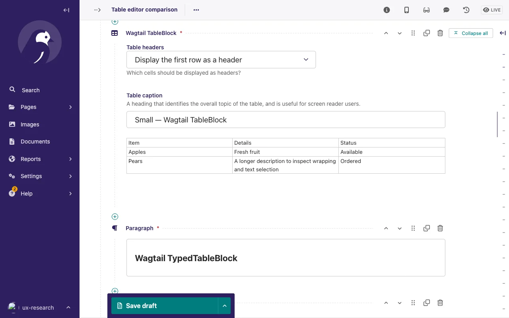](screenshots/hybrid/wagtail-tableblock-small.webp) | [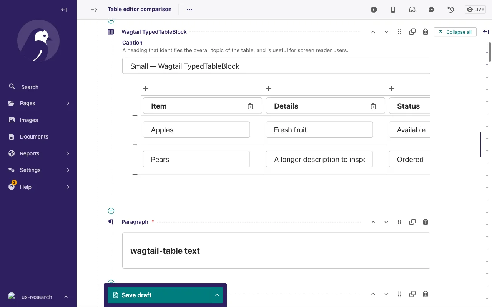](screenshots/hybrid/wagtail-typedtable-small.webp) |

| Our native text cells | Our embedded block cells |
| --- | --- |
| [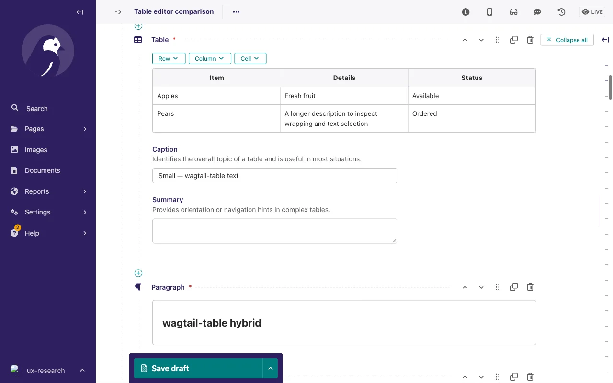](screenshots/hybrid/tiptap-small.webp) | [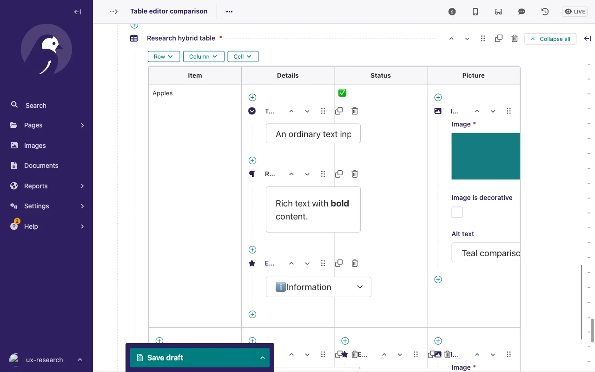](screenshots/hybrid/hybrid-block-cells.webp) |

**Observed:** native TableBlock selected Apples and Fresh fruit as a range during
pointer dragging. Tab then selected Fresh fruit and focused its editor textarea.
Our text table also selected those two cells, confirmed by a native ProseMirror
`CellSelection` and two `.selectedCell` decorations. These are single-session
checks, not broad keyboard conformance results.

[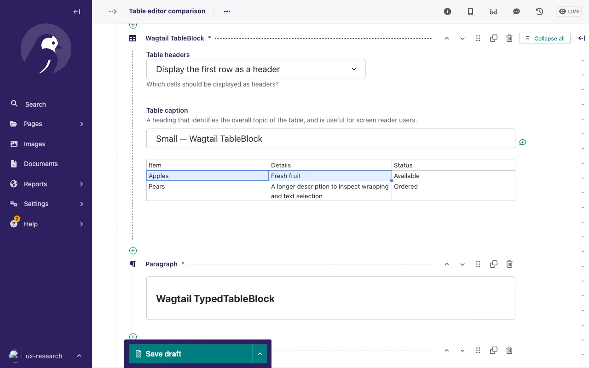](screenshots/hybrid/wagtail-tableblock-range.webp)
[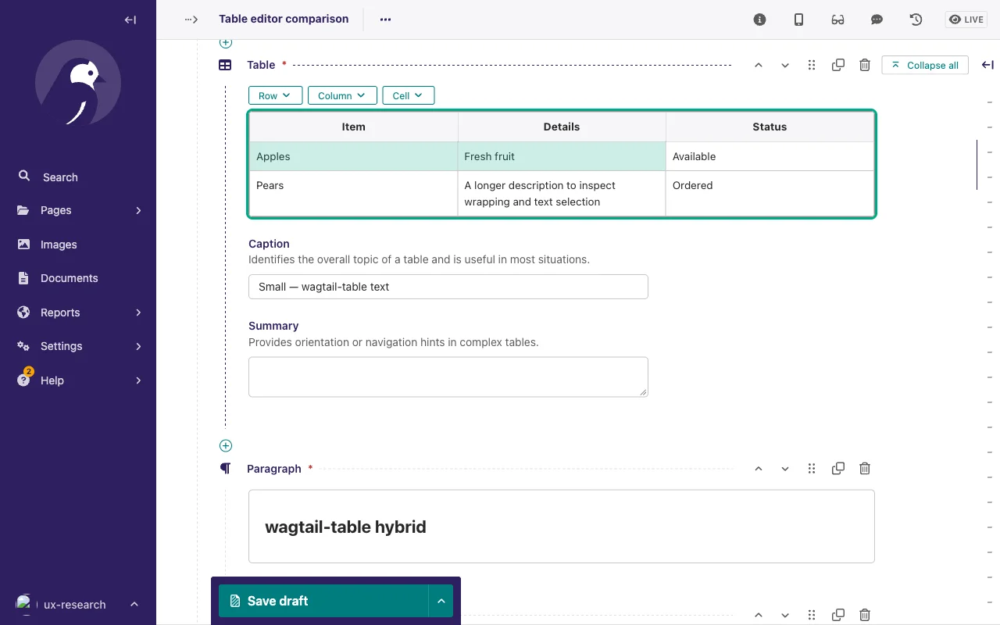](screenshots/hybrid/tiptap-cell-range.webp)

**Code:** Wagtail's installed TableBlock bundles Handsontable 6.2.2. Its interaction
model is a text grid. TypedTableBlock renders configured block widgets in columns,
with explicit structural controls rather than a ProseMirror rectangular selection.
Both are useful comparison points; neither proves a complete hybrid solution.
See [TableBlock](https://docs.wagtail.org/en/stable/reference/contrib/table_block.html)
and [TypedTableBlock](https://docs.wagtail.org/en/stable/reference/contrib/typed_table_block.html).

### Direct fields versus a StreamBlock wrapper

A focused second page, `/table-cell-content-comparison/`, compares the same text
in direct CharBlock, direct RichTextBlock, a StreamBlock limited to one item, and
a StreamBlock containing rich text plus an information emoji. Every case is
paired with native TypedTableBlock. The first comparison page is preserved.

| Configuration | Native TypedTableBlock | Our block cells |
| --- | --- | --- |
| Direct CharBlock | [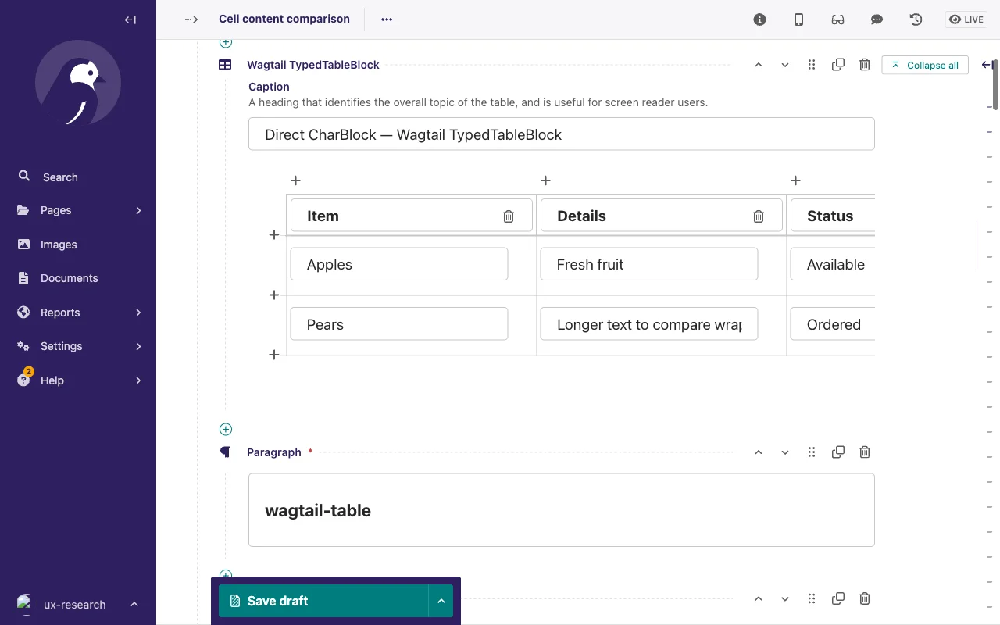](screenshots/hybrid/direct-typed-char.webp) | [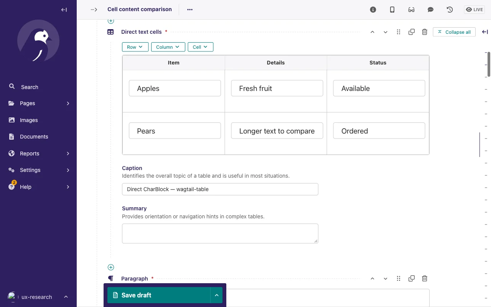](screenshots/hybrid/direct-hybrid-char.webp) |
| Direct RichTextBlock |  | [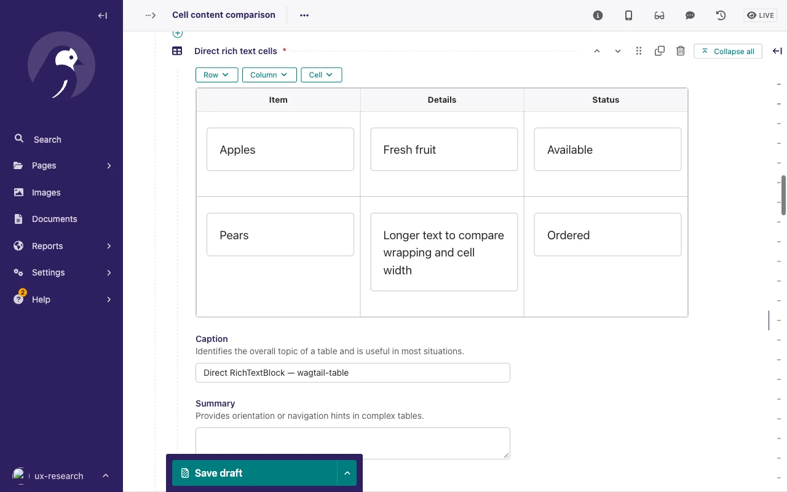](screenshots/hybrid/direct-hybrid-richtext.webp) |
| One-item StreamBlock | [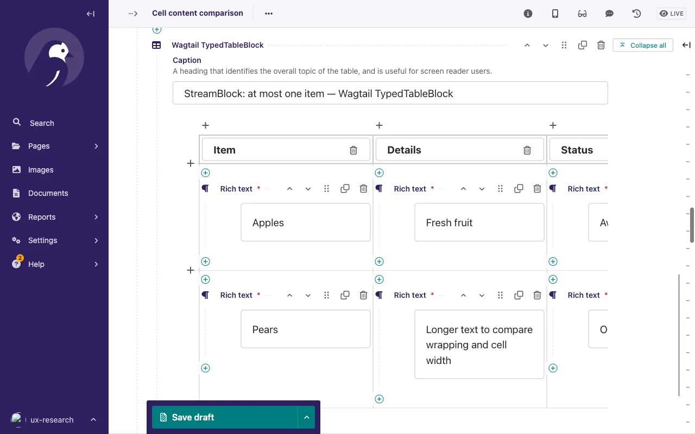](screenshots/hybrid/one-item-typed-stream.webp) | [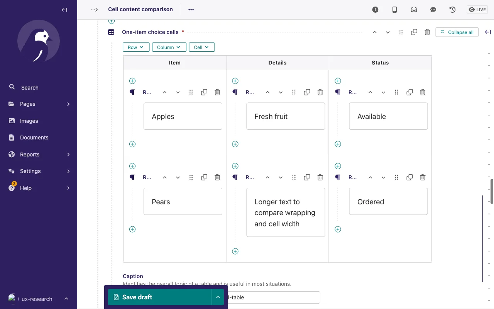](screenshots/hybrid/one-item-hybrid-stream.webp) |
| Multi-item StreamBlock |  | [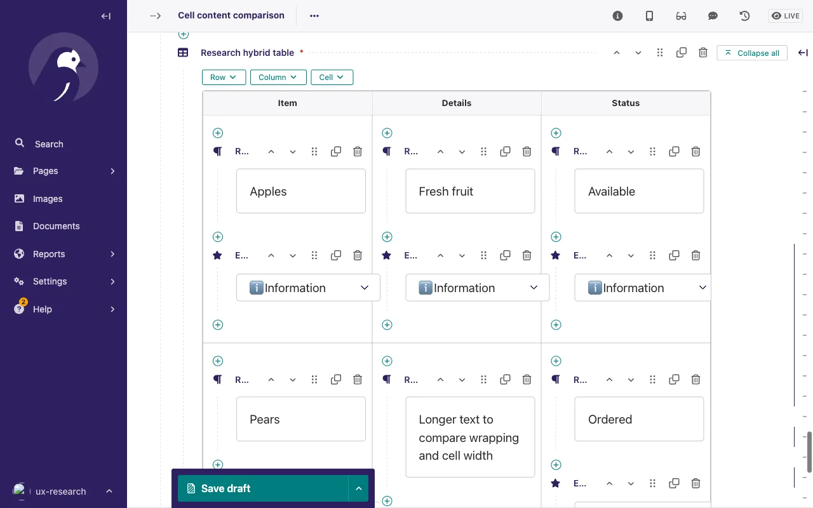](screenshots/hybrid/multi-item-hybrid-stream.webp) |

**Observed in the matched snapshot:** direct fields render without StreamBlock
item headers, sequence inserters, or reorder controls. One-item sequences still
expose those controls. For our six-data-cell tables, approximate table heights
were 259px (CharBlock), 372px (RichTextBlock), 536px (one-item StreamBlock), and
814px (two items). All had the same three columns at about 266px each. These are
fixture-specific layout measurements, not general performance/usability scores.
The two-item case deliberately adds an emoji; its content is not identical.

The first cell had 0/0/1/2 sequence items and 0/0/2/3 sequence insertion buttons,
respectively. Total DOM button counts were 1/1/9/16, including native field or
rich-text controls; a DOM count is not a count of always-visible controls.

**API already supported:** `TableBlock(cell_block=blocks.CharBlock())` and direct
RichTextBlock definitions fix the Wagtail type for converted cells. A native
StreamBlock with `max_num=1` offers a choice and validates at most one item, but
retains its sequence wrapper. The unrestricted StreamBlock remains available.
There is no new `single_block` option or storage format.

A single ImageBlock or StructBlock may still have several fields. Distinguish
field complexity, choice of type, and number of sequence items rather than
labelling every one-block configuration compact. Direct fields also retain the
outer node-view boundary and the caret/style issue diagnosed below.

## 2. What actually conflicts?

Direct fields have two layers: the outer table document and the configured
Wagtail field. StreamBlock cells add a third layer, the sequence and its item
controls. RichTextBlock has its own editing interaction even without a sequence.

| Interaction | Table intention | Embedded-editor intention / current boundary |
| --- | --- | --- |
| Click | Identify the current cell for commands | Focus a field, use a chooser, or activate a block action. Our pointer handler selects the **atomic content node**, not a `CellSelection`. |
| Triple-click | Native ProseMirror table handling can select a cell | Native input/rich-text text selection; events starting inside our node view are stopped before table handling. |
| Drag across cells | Select a rectangular range | Select text, drag an image, or use a StreamField block-reorder handle. These are separate operations; accepting all drags in the table would break some of them. |
| Arrows / Shift+Arrows | Navigate or extend a cell range | Move a caret, select text, or operate a select/menu. The focused widget must retain its normal keys. |
| Tab / Enter | Navigate cells or start editing | Navigate fields/actions, enter a paragraph, or activate a control. A cell can contain many tab stops. |
| Escape | Leave a table menu / return to table actions | Dismiss the innermost picker or dialog first. Our outer Escape handler deliberately skips embedded widgets. |
| Copy / paste / undo | Table range operations and table history | Native widget clipboard and rich-text history. The current package has separate histories and guards against lossy block-cell table clipboard operations. |
| Focus moves to a menu | Retain the cell/range being modified | Native widget state and caret may remain live while the outer document has an atomic node selection. |

**Code:** the node view uses `contentEditable=false`, `stopEvent: () => true`, and
`ignoreMutation: () => true` to protect native Wagtail widgets. Its pointer-down
listener explicitly dispatches `NodeSelection`. This is intentional integration
glue, not proof that both engines independently process every gesture. Dragging
from padding works because it starts outside that protected node view.
See [the integration](https://github.com/allcaps/wagtail-table/blob/main/frontend/hybrid.ts) and
[outer focus handling](https://github.com/allcaps/wagtail-table/blob/main/frontend/wagtail.ts).

**Observed:** dragging from the hybrid's ordinary input into the neighbouring
text cell left the outer selection as a node selection and selected zero table
cells. The same operation from text-table content produced a cell range. This
supports a clearer entry point or editing boundary; it does not justify taking
all pointer events away from input fields.

### Missing caret and selection highlight: a specific cause

**Observed:** programmatically focusing the CharBlock and selecting “ordinary”
showed a visible selection. After a real pointer click, both the ordinary input
and nested rich-text surface instead inherited a transparent caret. A subsequent
Shift+Arrow selection in rich text existed in the DOM even though its background
was transparent.

[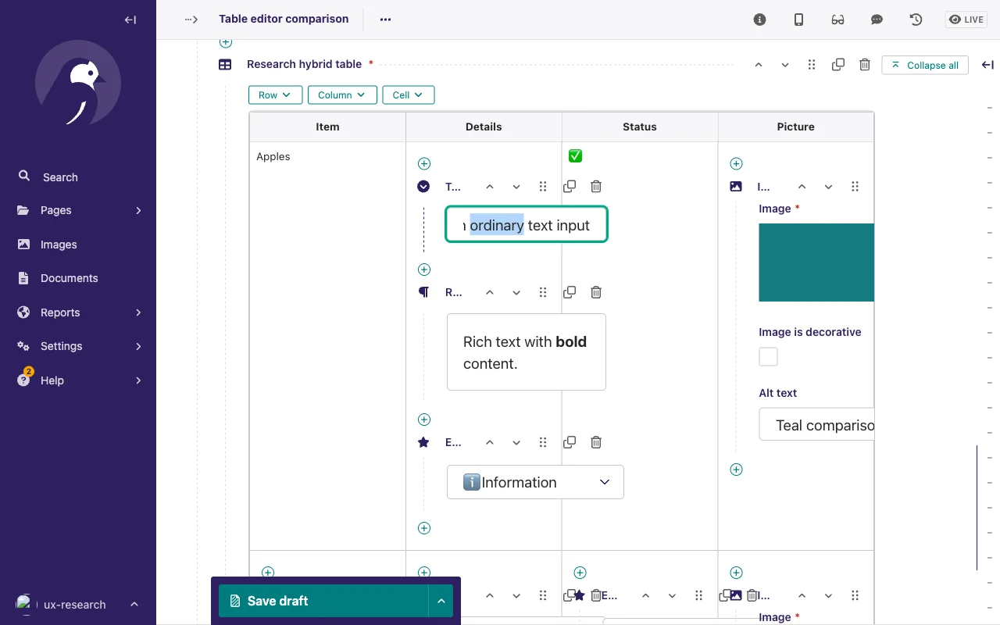](screenshots/hybrid/hybrid-text-input-focused.webp)
[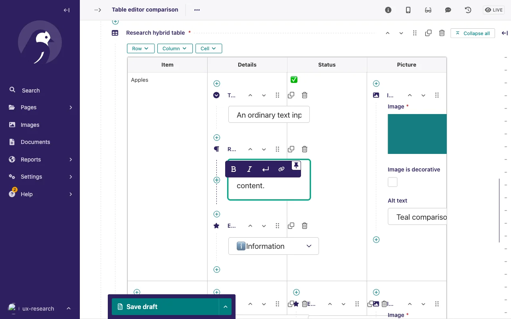](screenshots/hybrid/hybrid-richtext-selection-hidden.webp)

**Code and observed CSS:** the outer node selection activates
`.ProseMirror-hideselection`. Tiptap 3.34.0 injects descendant rules for
`*::selection` and `*` that make selection backgrounds and carets transparent.
The actual computed caret colour after clicking was `rgba(0, 0, 0, 0)` in both
embedded field types. The installed source is
`node_modules/@tiptap/core/src/style.ts`; ProseMirror also has selection-hiding
styles in `node_modules/prosemirror-view/style/prosemirror.css`.

This is a concrete isolation defect in this integration. It is separate from the
choice of dialog, side panel, or inline editing. A focused follow-up should test
scoped style isolation or selection/focus handling without disabling native table
selection styling. This study deliberately does not apply a blanket CSS override.

## 3. Space, scrolling, and compact controls

**Observed at 1280×800:** the admin block was approximately 838px wide; its table
wrapper was 800px. Four fixed-layout columns were about 200px each, while an
embedded block editor had `min-width: 256px`. The wrapper's scroll width was 975px.
Fields and actions spilled into neighbouring cells even though a scrollbar
already existed. Adding the same minimum-width rule again would not solve this.

The wide text fixture remained an 800px table with twelve narrow columns; it did
not expand into a wider working surface merely because many columns existed.

[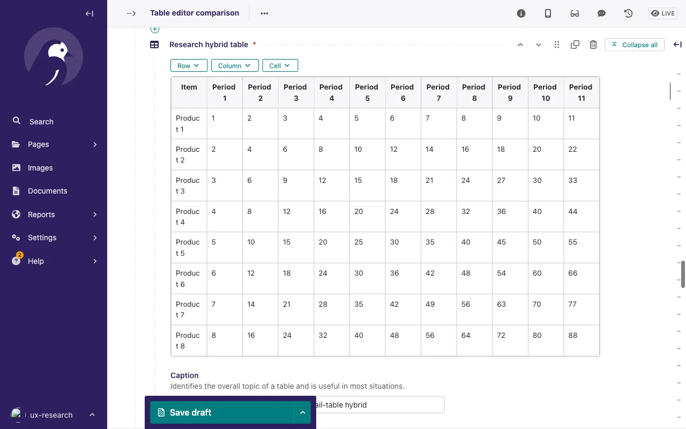](screenshots/hybrid/hybrid-wide.webp)
[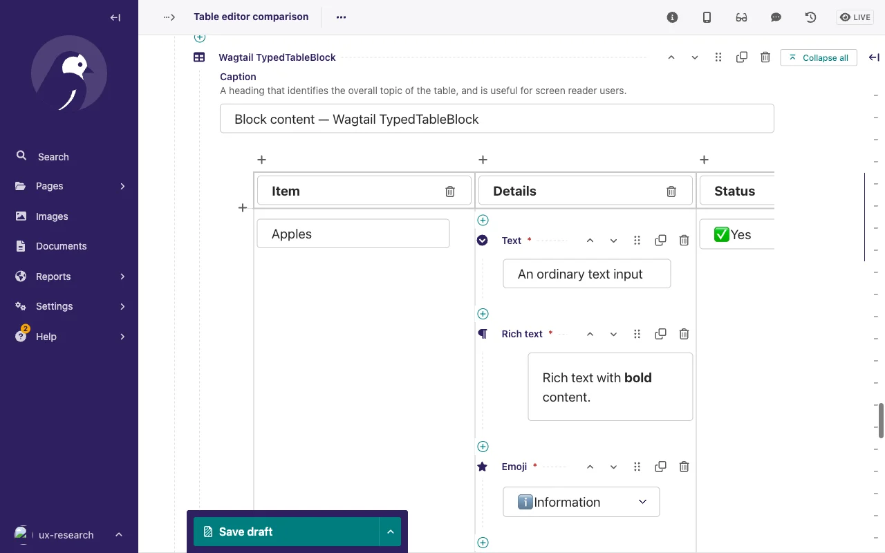](screenshots/hybrid/typedtable-block-cells.webp)

**Code:** our table uses `table-layout: fixed; width: 100%`; the wrapper already
has `overflow-x: auto`. Minimum width on a descendant editor does not allocate
that width to its table column. Research a table/column sizing policy together
with scrolling, not as independent CSS toggles. Preserve resize behaviour, merged
cells, sticky/contextual controls, and nested chooser positioning in any prototype.
See [current styles](https://github.com/allcaps/wagtail-table/blob/main/frontend/editor.css).

A larger workspace and full-screen editing are complementary to either proposed
interaction model. An expanded admin workspace may be enough; the browser
Fullscreen API is not a prerequisite. Test exiting with focus and scroll position
restored, and what happens when an image chooser opens above that workspace.

### Which StreamField chrome matters inside a cell?

Inventory, rather than indiscriminately hide: block heading/type label, collapse
control, insertion points, move/reorder, duplicate, delete, anchor/permalink,
required indicator, field labels/help, validation errors, and chooser actions.

Anchor links are a candidate for removal from a compact cell presentation; the
heading's accessible name and relationships are still needed. Do not hide labels,
errors, or all keyboard actions along with visual chrome. Determine whether a
supported block option or form layout is available before adding selectors tied
to Wagtail's internal markup. The configured block still owns its fields.

## 4. Can a StreamBlock render itself? What is a quiet state?

**Yes, on the server:** Wagtail blocks support `render(value, context)` and
``. A StreamBlock renders its child values through their block
definitions. This package already uses that path for published block-cell content.
It is not a generic browser-side renderer for an arbitrary native form state.
See [block rendering](https://docs.wagtail.org/en/stable/topics/streamfield.html#template-rendering).

| Quiet representation | Reuse available | Main limitation / next check |
| --- | --- | --- |
| Native collapsed blocks | `collapsed=True`, existing toggle and text summaries | Less height, but still many headers/actions; summary is not rendered content. |
| Compact inactive form | Native widgets plus supported form classes/layouts | Hidden controls must not retain confusing focus targets; error and chooser states need exceptions. |
| Content summary | Native text-label summaries where available; deliberate thumbnail/count conventions | Not every arbitrary block provides a useful concise label or thumbnail. Define a fallback before calling it universal. |
| Rendered current value | Native Python block rendering and integrator templates | Unsaved widget state must first be decoded into native values; incomplete data, request context, assets, and refresh cost require investigation. |
| Scaled inactive editor | CSS transform/zoom is technically possible | Smaller text and targets, awkward geometry and popovers; it neither removes controls nor resolves event ownership. Low priority. |

**Observed:** collapsing the native child blocks reduced the hybrid editor from
about 1365px to 793px high, but retained block headers/actions and still-overflowing
widths. It did not display the final content. That is a useful baseline, not the
same as a content preview.

Wagtail documents [collapsed StreamBlocks and form options](https://docs.wagtail.org/en/stable/reference/streamfield/blocks.html).
`label_format` is a StructBlock summary option, not a general live preview API.
`form_classname`/`form_attrs` provide hooks, not a built-in compact table-cell mode.
These options should be checked per block type rather than assumed interchangeable.

### Three meanings of preview

| Purpose | Source of value | What it promises |
| --- | --- | --- |
| Block-picker preview | `preview_value` / `get_preview_value()` and a preview template | An example to help choose a block, not necessarily the current cell value. |
| Quiet representation of a cell | Current unsaved native form state, decoded if rendering is needed | An editing aid. It may be deliberately condensed and is not a promise of final page layout. |
| Whole-page preview | The page preview workflow and full page context | The page presentation, including surrounding layout and frontend assets. |

Wagtail's [block-picker preview documentation](https://docs.wagtail.org/en/stable/topics/streamfield.html#configuring-block-previews)
explains its example values and full-document preview templates. Frontend CSS and
other assets are not automatically supplied by the default preview template.
That feature should not be relabelled as an existing live cell preview.

**Proposal:** reuse canonical block rendering where useful, while giving a cell
representation its own admin framing and isolated styles. Do not change published
renderers merely to make them fit an editor. Do not inject arbitrary frontend CSS
or scripts into the admin document. Evaluate template context, permissions,
incomplete values, request cancellation/stale results, and safe fallbacks before
introducing a rendering endpoint. No such endpoint is added in this pass.

[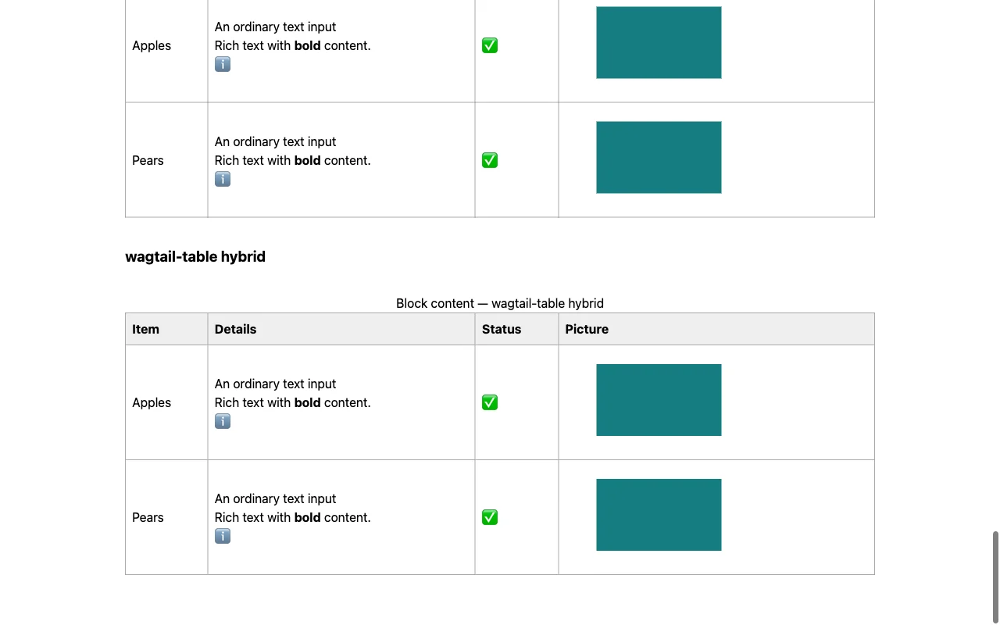](screenshots/hybrid/published-block-content.webp)

This last image is Django's public-page response, not a test of Wagtail's live
page-preview UI. It illustrates why native rendering can supply content while
its layout and styling remain a separate concern.

## 5. Industry patterns to borrow, not dependencies

| Pattern | Primary evidence | Relevance and caution |
| --- | --- | --- |
| Navigation versus editing inside a cell | [WAI grid guidance](https://www.w3.org/WAI/ARIA/apg/patterns/grid/) describes entering a widget and restoring navigation with keys such as Enter/F2/Escape. | Useful model for focus ownership. Do not add `role=grid` to a rich-text table without implementing and testing its keyboard/accessibility contract. |
| Display surface versus an active editor | [AG Grid editing](https://www.ag-grid.com/javascript-data-grid/cell-editing-start-stop/) documents explicit start/stop editing and keyboard transitions. | A selected cell need not expose every widget. Its default commit/cancel behaviour cannot simply be copied onto a multi-block StreamField. |
| Compact overview with expanded details | [Airtable expanded records](https://support.airtable.com/articles/3516802427-record-level-revision-history-in-airtable) documents opening a selected record, including a Space shortcut. | An analogy for rich cell editing elsewhere. A record is not a table cell; compare cost of opening many cells. |
| Side, centre, and full-page detail views | [Notion view settings](https://www.notion.com/help/views-filters-and-sorts#open-pages-in) describes side peek, centre peek, and full-page opening. | Shows that editing location can be a deliberate choice. A side panel consumes width, and a modal must handle nested choosers and focus return. |
| Contextual structural controls | [Earlier TinyMCE/CKEditor study](comparison.md) contains live observations and captures. | Keep table actions discoverable while reducing persistent chrome. Focus/hover controls need a keyboard/touch route. |

The first four references are documentation evidence only in this pass. No account
was created, no enterprise feature or vendor code was installed, and no new live
usability claims are made about those products. Their documentation was checked
on 22 November 2026.

## 6. Proposed next experiments, ranked

Prefer direct native blocks when integrators need one fixed field type per cell.
They do not need a StreamBlock-based quiet-state redesign merely to remove
sequence controls. First-class demo and browser coverage now includes those
configurations. The larger UX experiments below primarily target type choices,
complex forms, and multi-item cells; their scope should not force additional
opening or mode-switching steps onto simple fields.

First, review the diagnosed caret/selection style leak as a separate correctness
fix. It should not be judged as evidence that all inline editing must be abandoned.
Then prototype one interaction model at a time.

### 1 — Compact cells with a separate active-cell editor

Keep a selectable table overview and open the selected block cell in a dedicated
editor area, using native Wagtail widgets. Compare a side panel against Wagtail's
modal patterns; do not create another block editing framework. Start with honest
summaries, not an assumed universal live renderer. Evaluate server-rendered quiet
content only when summaries are insufficient.

Why first: it gives table selection and form editing separate pointer surfaces,
removes most persistent controls from the grid, and gives arbitrary configured
blocks enough room. Main costs are opening cells repeatedly, associating the
editor with its cell, unsaved-value handling, and nested chooser/focus behaviour.

Acceptance for a prototype: select a mixed 2×2 range without entering a field;
open a cell by pointer and keyboard; edit three child blocks; use an image chooser;
return focus to that cell with content intact; keep other table instances
independent; save/reload without losing values or resetting native widget state.

### 2 — One active inline editor with an explicit selection mode

Keep inline editing but make the current mode visible. Quiet inactive cells and
limit expanded native controls to the active editing cell. Ensure the editor can
leave the field and select a range without hunting for padding. Preserve the
native widget instances/state while evaluating collapse/hide behaviour.

Why second: it retains direct context and may reuse more of the current hosting
code, but mode errors and hidden focus targets need careful testing. Hover alone
must not be the mode switch. A visible keyboard-accessible entry and exit are
required; avoid a new range-selection engine.

Acceptance: distinguish text selection from a mixed-cell range, enter and leave
editing by keyboard, keep rich-text/chooser keys local, show errors in quiet
cells, and preserve changes across mode switches, duplication, and save/reload.

Width/scrolling and an expanded workspace should be tested alongside either
model, not used as substitutes for solving interaction ownership. Scaling is a
lower-priority comparison, not a recommended first prototype.

## Remaining evidence and checklist

- Run the new Playwright comparison test and the existing hybrid journey against
  a local server. The latter covers rich text, images, duplication, drafts, and
  publication, but this research pass cannot claim that HTTP journey passed.
- Repeat pointer selection and the caret diagnosis in Firefox/Safari and with a
  keyboard-only user; test touch and screen readers separately.
- Compare narrow and expanded workspaces, actual scrollbar usability, zoom,
  popover boundaries, and row heights. Only the normal-width baseline is captured.
- Exercise structural menus, merge/split where supported, nested block reorder,
  external clipboard data, and chooser return in the four-editor page. The source
  and current tests do not establish equal support across editors.
- Review invalid/incomplete block values, dirty-state signalling, asynchronous
  preview updates, and page-preview context before any quiet-state implementation.
- Compare discoverability and task completion with editors; screenshots and one
  developer's interaction probes are not a usability study or accessibility audit.

## Direct-cell verification extension

The direct CharBlock and RichTextBlock cases now have explicit tests for JSON
round trips, native POST decoding, rendering, defaults, required-field validation,
and draft deferral. A configured one-item StreamBlock rejects two items through
native validation; the existing unrestricted multi-item tests still pass.
The focused page is independently seeded, so existing comparison edits survive.

In the isolated admin snapshot, real keyboard input updated a direct CharBlock
and a direct RichTextBlock. Native outer StreamField duplication retained both
values, including Draftail's opaque editor state. Converting a populated CharBlock
cell back to text after confirmation produced a native paragraph and left the
original table's value intact. These local DOM checks do not prove HTTP saving.

`make test` passes with 124 Python and 38 TypeScript tests. The 17-test browser
suite includes focused direct-field editing, duplication, save/reload, and
conversion scenarios. The new HTTP journey is collected but has not been run
under the sandbox restrictions; run `make test-browser` locally. The eight new
captures use the same offline snapshot method as the twelve earlier captures.
No production package API, schema, styling, or default limit was changed.
